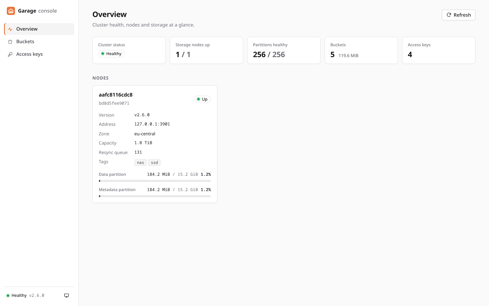
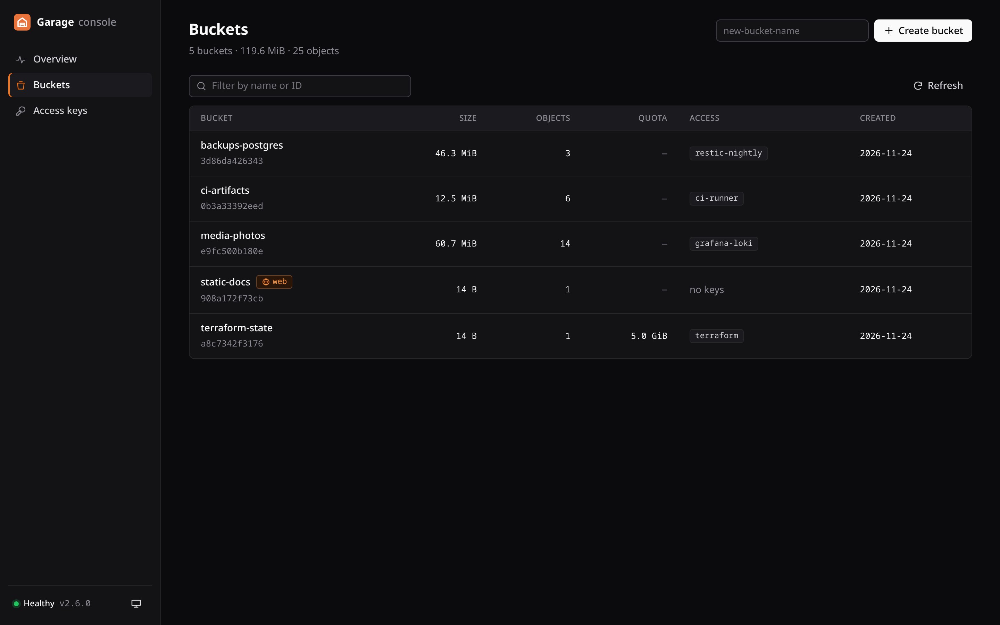
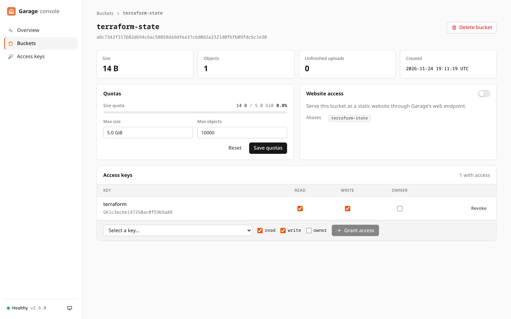
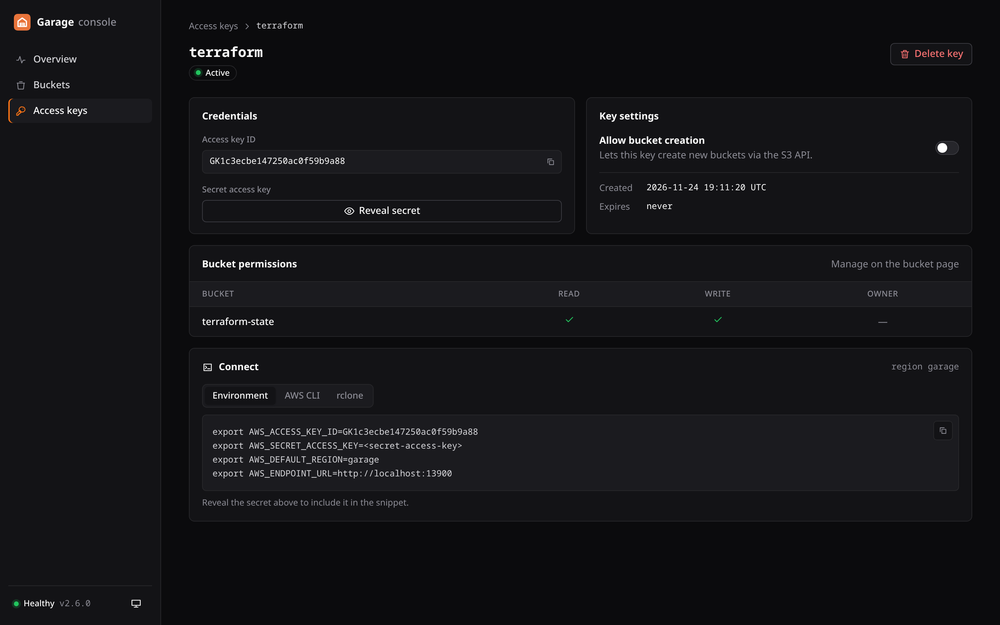

# Garage Console

A small web console for [Garage](https://garagehq.deuxfleurs.fr/) S3 clusters. You can manage buckets, access keys, permissions and quotas, and copy ready-to-use connection snippets. It ships as one ~10 MB container (Go + Vue) for amd64 and arm64.



| Buckets | Bucket detail |
| --- | --- |
|  |  |

| Access key with connection snippets |
| --- |
|  |

## Run

Requires Garage v2 (Admin API v2).

```yaml
services:
  garage-ui:
    image: ghcr.io/miggiv2/garage-ui:latest
    restart: unless-stopped
    environment:
      GARAGE_ADMIN_URL: http://garage:3903
      GARAGE_CONFIG_FILE: /etc/garage.toml
      S3_ENDPOINT: https://s3.example.com
    volumes:
      - ./garage.toml:/etc/garage.toml:ro
    ports:
      - "8080:8080"
```

| Variable | Default | Description |
| --- | --- | --- |
| `GARAGE_ADMIN_URL` | `http://garage:3903` | Garage admin API |
| `GARAGE_ADMIN_TOKEN` | – | Admin token; alternatively read from `GARAGE_CONFIG_FILE` |
| `GARAGE_CONFIG_FILE` | – | Path to `garage.toml`; provides `admin_token` and `s3_region` |
| `S3_ENDPOINT` | – | Public S3 endpoint shown in connection snippets |
| `S3_REGION` | from config, else `garage` | Region shown in connection snippets |
| `UI_USERNAME` / `UI_PASSWORD` | – | Enables HTTP basic auth when both are set |
| `LISTEN_ADDR` | `:8080` | Listen address |

The admin token stays on the server. The backend forwards only the admin operations the UI needs. Cluster layout, admin tokens and workers are not reachable. Without `UI_USERNAME`/`UI_PASSWORD` anyone who can reach the console can manage your cluster, so run it on a private network or behind an authenticating proxy.

## Develop

```sh
cd web && npm ci && npm run dev    # Vite on :5173, proxies /api to :8080
GARAGE_ADMIN_TOKEN=… GARAGE_ADMIN_URL=http://localhost:3903 go run .
go test ./... && (cd web && npm test)
```
